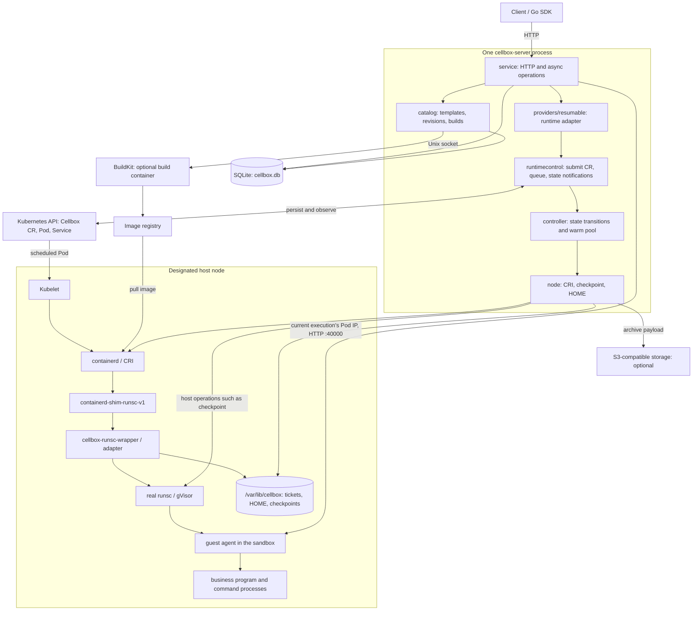

# Architecture and creation flow

This page describes the architecture of the current single-node Kubernetes implementation, how a node is onboarded, and how a Box is created, suspended and resumed. For client examples see the [Go SDK](go-sdk.md) and the [REST quick start](rest-quickstart.md); for deployment commands see the [deployment guide](deployment.md). Terms are defined in [concepts](concepts.md).

## 1. Nodes versus Boxes

| Name | Meaning |
| --- | --- |
| Host node / Kubernetes Node | A machine you prepare in advance. It runs kubelet, containerd and gVisor. Cellbox does not create virtual machines and does not join nodes to Kubernetes. |
| `cellbox-server` | A service process pinned to one node. It provides the HTTP API, the controller and the node backend. |
| Box (sandbox) | The instance exposed through the API, created from a template revision. It is not a Kubernetes Node. |
| Cellbox custom resource | The Kubernetes object that stores a Box's desired runtime state, current execution identity and checkpoint reference. It owns the Pod and the Service. |
| Pod | The Kubernetes object for one run or resume. It is deleted on suspend; resume creates or claims another Pod. |
| gVisor sandbox | The isolated runtime environment of the Pod. The business container and its processes run here. |
| Guest agent | `cellbox-container-agent` inside the business container. It starts the business program, runs commands and serves file access. |

"Creating a node" therefore means two separate things: an operator onboards a host node, and a client later creates Boxes on that node through the API. Both are described below.

## 2. Overall architecture



The API and the controller run in the same process. A lifecycle change is first written to Kubernetes; once that write succeeds it is added to a local work queue. After the controller commits a new state, it notifies waiters through a local subscription. There is no HTTP or RPC between separate controller services, and no ConfigMap is used to pass these notifications.

Kubernetes API calls, Pod scheduling, CRI calls and HTTP calls to the guest still happen. The `cellbox-server` Pod runs privileged with `hostPID` and host mounts so it can operate on its node; this does not put it in the same isolation boundary as the Boxes.

### Code map

| Code | Responsibility |
| --- | --- |
| [`cmd/cellbox-server`](../cmd/cellbox-server) | Starts and wires the components, keeps a single active process, orders shutdown |
| [`internal/service`](../internal/service) | Public HTTP, Box and operation records, lifecycle orchestration, guest requests |
| [`internal/catalog`](../internal/catalog), [`internal/image`](../internal/image) | Templates and revisions, image resolution, BuildKit builds and publishing |
| [`internal/boxprovider`](../internal/boxprovider), [`internal/providers/resumable`](../internal/providers/resumable) | Interface and adapter between the service layer and the Kubernetes runtime |
| [`internal/runtimecontrol`](../internal/runtimecontrol) | Shared Kubernetes client, per-object queueing, notifications of committed state |
| [`internal/controller`](../internal/controller) | Advances CR state, creates and deletes Pods and Services, maintains the warm pool |
| [`internal/runtime`](../internal/runtime) | The narrow interface the controller uses to call the node backend; not a separate service |
| [`internal/node`](../internal/node) | Queries and cleans up CRI executions; prepares tickets, checkpoints and restore; cleans node files |
| [`internal/adapter`](../internal/adapter) | Library used by the wrapper: checks tickets on runsc `create` and `start`, binds HOME, rewrites a `start` that must restore into `restore` |
| [`internal/guest`](../internal/guest), [`internal/guestapi`](../internal/guestapi) | The agent inside the sandbox and the protocol shared by the server and the agent |

## 3. How a host node is onboarded

Cellbox has no API for creating host nodes. An operator prepares the machine first, then deploys the server:

1. Install Kubernetes or k3s so the machine is already a Kubernetes Node.
2. Install the Cellbox gVisor build, its shim and the Cellbox wrapper, and configure the containerd `runsc-recoverable` handler. The shim runs a wrapper script, which sets the environment and executes `cellbox-runsc-wrapper`, which finally executes the real `runsc`.
3. Deploy the chart with `server.nodeName`, the namespace, the CRI socket and the persistent data directory. The chart creates the Kubernetes resources; host components are installed separately.
4. The Kubernetes profile in the server must point at the same node and namespace. There is no multi-node scheduler; a higher layer decides which single-node server to use.

For installation, runtime configuration and upgrade limits see the [node installation guide](node-installation.md).

### What the server does at startup

The entry point is [`main.go`](../cmd/cellbox-server/main.go). Components are assembled in `newRuntime` and `serveUnified` in [`runtime.go`](../cmd/cellbox-server/runtime.go):

1. Validate the configuration and acquire a Kubernetes Lease scoped to the node and namespace, so only one process is active. This protects the server process and is unrelated to any Box.
2. Create the provider, the shared `runtimecontrol.Client`, the controller manager and `node.Backend`, and connect to the local CRI.
3. Open the single `cellbox.db`, initialize the service and catalog, and hand the shared checkpoint index and archive storage to the node backend.
4. Start the HTTP server, the reconcile loops, warm pool maintenance and node cleanup. CR and Pod watches observe external changes and re-advance existing resources after a restart.

Background loops run in parallel with the HTTP handlers. Work on one Box is queued by object key; different Boxes progress in parallel, so node operations are not serialized into one large task.

## 4. Before creation: from template to runnable revision

```text
Administrator configures a profile
  -> create a template
  -> submit a build: base image + buildCommand + runCommand + profile
  -> resolve the base image digest; BuildKit installs tools and injects the guest agent
  -> publish the image; store an immutable revision and a snapshot of the runtime configuration
  -> create from the revision directly, or point the template's stable revision at it first
```

`buildCommand` runs in the build container and can install custom tools. It does not run again when a Box is created. `runCommand` is startup configuration input, parsed as literal `docker run ...` syntax; the server never runs a Docker command for it. The guest agent starts the business command, and the Kubernetes container's entry point is the injected agent.

At creation, `templateId` resolves to the stable revision at that moment, while `revisionId` pins a specific revision. The resolved image digest, CPU, memory and guest configuration are stored in the Box's record, so later changes to the stable pointer do not affect existing Boxes. For revisions, tool updates and warm configuration see [usage](cellbox-usage.md).

## 5. Creating a new Box

The example is a Kubernetes Box with no checkpoint and `staged=false`. The request:

```http
POST /v1/boxes
Content-Type: application/json

{"revisionId":"rev-...","ownerKey":"your-label"}
```

`revisionId` can be replaced by `templateId`; exactly one of the two must be given. `ownerKey` is a label for your own bookkeeping. It is not unique and does not de-duplicate requests.

### 5.1 From HTTP to Kubernetes objects

```mermaid
sequenceDiagram
    participant C as Caller
    participant A as service
    participant D as SQLite
    participant P as provider / runtimecontrol
    participant K as Kubernetes API
    participant R as controller / node

    C->>A: POST /v1/boxes
    A->>D: transaction: save Box and operation
    A-->>C: 202 + operation
    Note over A,P: An async worker continues; it may run in parallel with the response
    A->>P: provision -> Provider.Create
    P->>K: create Cellbox CR, desired state Running
    P->>R: queue locally after the write succeeds
    P-->>A: return CR handle
    A->>D: save handle
    Note over R,K: Several reconcile passes advance the state
    R->>K: create Service
    R->>K: begin: update CR with Creating / cycle / Pod name
    R->>K: create Pod with a SchedulingGate
    R->>R: node.Prepare: HOME, ticket
    R->>K: write ticket annotation, remove gate
    Note over K,R: The scheduler, kubelet and containerd then start the runtime
    R->>K: confirm execution, open guest admission, record Running
    R-->>A: local notification of committed state
    A->>A: observe state and call guest /healthz
    A->>D: operation -> succeeded; on failure record the error
    C->>A: GET /v1/operations/{id}
    A-->>C: operation result
```

`202` means the request was accepted. The async worker may already be running before the response is sent, so it does not guarantee that the CR exists, and it does not mean the Box is usable.

The steps in detail:

1. **The service accepts the request.** `create` validates input, resolves the revision from SQLite, saves `Box(creating)` and the operation in one transaction, and starts `provision`. The request does not wait for the Pod.
2. **The provider creates the CR.** `buildWanted` converts the configuration into a `Cellbox` custom resource with the node, image, resource limits and agent entry point fixed. `Provider.Create` returns a handle tied to the CR UID and does not create a Pod itself. In the source the Go type is still called `ResumablePod`; the Kubernetes kind is `Cellbox`.
3. **The controller creates the Service and the Pod.** It adds a cleanup finalizer to the CR and creates a Service owned by it. `begin` increments the execution cycle, picks the Pod name and writes `Creating`. Later reconcile passes create the Pod, also owned by the CR, with `RuntimeClass=runsc-recoverable`, a node selector and `RestartPolicy=Never`.
4. **Scheduling is allowed once preparation is done.** The Pod starts with a `cellbox.jingyugao.github.io/prepared` SchedulingGate, so the scheduler ignores it. After the controller knows the Pod UID, it calls `node.Backend.Prepare`, which prepares the persistent HOME (when enabled) and a ticket bound to that Pod. It then writes the ticket annotation and removes the gate. This step only prepares the conditions to run; it does not start a container.

The Service may already exist at this point without anything to serve. It selects the current Pod through the CR owner UID and the `serving` label, and keeps its identity across suspend and resume.

Source: [HTTP entry](../internal/service/http.go), [`create/provision/waitState`](../internal/service/service.go), [`buildWanted/Provider.Create`](../internal/providers/resumable/provider.go), [`begin/Reconcile`](../internal/controller/reconciler.go), [`executionPod`](../internal/controller/warm_pool.go), [`Prepare`](../internal/node/backend.go).

### 5.2 From kubelet to the business process

```text
The scheduler assigns the Pod to the designated node
  -> kubelet calls containerd CRI, pulls the image, prepares the Pod
  -> create the PodSandbox (root sandbox)
      -> shim -> wrapper create: check Pod and ticket -> runsc create
      -> shim -> wrapper start: cold start keeps the original command -> runsc start
  -> create the business container inside the sandbox
      -> shim -> wrapper create: check identity, bind persistent HOME -> runsc create
      -> shim -> wrapper start: check the current execution -> runsc start
  -> container entry point: cellbox-container-agent serve
      -> Bootstrap prepares the user, directories and tool environment
      -> non-staged Boxes start the business program
      -> serve the guest HTTP API on :40000
```

The shim is `containerd-shim-runsc-v1`. It runs the wrapper script in place of `runsc`; the script executes `cellbox-runsc-wrapper`, and `internal/adapter` is the library the wrapper uses. The wrapper gets authorization and restore parameters from the shared node ticket files, so it needs no RPC to `cellbox-server` and does not read SQLite. After checking and, when needed, rewriting the arguments, it executes the real `runsc`.

There are two layers: the gVisor root sandbox, and the business container inside it that runs the agent. HOME is bound in the business container's OCI `create` path, so writable directories of different Boxes are never mixed. The ticket also checks identity, such as the Pod UID, and rejects preparation records that do not belong to the current execution.

Source: [wrapper entry](../cmd/cellbox-runsc-wrapper/main.go), [`Adapter.Rewrite/Main`](../internal/adapter/adapter.go), [HOME binding](../internal/adapter/home.go), [agent entry](../cmd/cellbox-container-agent/main.go), [guest startup](../internal/guest/server.go).

### 5.3 When creation counts as done

| Stage | What it tells you | What it does not tell you |
| --- | --- | --- |
| HTTP `202` | The operation is persisted and accepted | That the CR, Pod or container exist |
| CR created | The desired runtime state is written to Kubernetes | That the Pod has started |
| Container execution confirmed, CR `Running` | The controller confirmed the current execution and opened guest admission | That the business service is healthy |
| Create operation `succeeded` | The service saw the target state and reached the guest `/healthz` | That the business port is initialized or the application passed its own checks |

The Pod's TCP readiness probe checks the guest port, and the create operation also waits for guest HTTP `/healthz`. Neither is a health check of your application. Wait for the operation to finish, then check your own application endpoint if you need application readiness.

With `staged=true`, the guest control API starts but the business program does not. The created Box is `staged` until the caller activates it explicitly.

## 6. Suspend, resume and the warm pool

Suspend differs from a fresh create in that it saves process state:

```text
suspend
  -> guest quiesce: check for active commands and close the entry for new ones
  -> set the CR desired state to Suspended
  -> controller withdraws serving; node takes a gVisor checkpoint and commits node files
  -> delete the old Pod; the CR becomes Suspended

resume
  -> update the CR desired state and this transition
  -> controller begin: claim a compatible warm slot if there is one, otherwise create a standard restore Pod
  -> node verifies checkpoint / HOME / runtime identity and prepares the restore ticket
  -> wrapper turns the start into runsc restore
  -> confirm the new execution, reopen guest admission, publish Running
  -> service sees Running + GuestReady for this transition, then completes the operation
```

Resume keeps the Box and the CR, but the Pod UID and the execution generation can change. After the operation, use the new handle returned by the SDK; with REST, query the Box again. Resume uses the checkpoint on the same node; there is no automatic cross-node migration.

Resume completes differently from first creation. The node backend first confirms the execution identity through the CRI. It then calls the guest resume endpoint on the exact Pod IP, which reopens admission. After the controller commits the ready state for this transition, the service completes the operation from its in-process observation and does not poll guest `/healthz`. See [`launchNodeResume`](../internal/service/node_resume.go), [`waitNodeResume`](../internal/service/runtime_feed.go) and [`node.ResumeGuest`](../internal/node/resume_guest.go).

### What warming does ahead of time

Warm demand comes from the checkpoints on the node. The pool loop lists, every 500 ms, the Boxes on this node that are `Suspended` and have a checkpoint, groups them by compatible runtime configuration (1-2 slots per group), and, within the node's total budget, creates compatible Pods and gVisor root sandboxes ahead of time. A revision's `warmSlots` no longer decides demand.

How an idle slot waits depends on the wrapper mode, set by the node's wrapper script (see [warm pool](warm-pool.md) for the full comparison):

- **Deferred mode** (`CELLBOX_NO_ROOT_CONTAINER=true` and `CELLBOX_DEFER_CHECKPOINT=true`; the validated path). The root sandbox is started right away with `runsc restore --defer-checkpoint --background --detach` and no checkpoint. The business container is created ahead of time without Box-specific mounts, and its `start` waits for assignment (`WaitWarm`, 60-second lease).
- **Standard mode** (neither variable set). The wrapper blocks in the root sandbox `start` until a Box claims the slot.

In both modes an idle slot has no business program or guest agent running, and the pool's `readySlots` only means the slot reached its waiting state.

After a resume claims a slot, the node backend prepares the Box's ticket, checkpoint and HOME and wakes the waiting wrapper. In deferred mode the wrapper then verifies and consumes the checkpoint, binds HOME into the pre-created business container, and restores with `--background --background-load=<mode>`. In standard mode it does the same at the root sandbox's `start`. `CELLBOX_BACKGROUND_LOAD` (`lazy` by default, or `eager`) sets `<mode>` for restores that bind a checkpoint. The idle pool never mounts a particular Box's HOME ahead of time.

Revisions with the same compatibility fingerprint can share a pool; different images or runtime configurations cannot be mixed. A pool belongs to a compatible configuration, not to one business Pod.

**Creating a new Box does not claim a warm slot.** `begin` tries `WarmPool.acquire` only when `Status.Snapshot` is set. On a pool miss, the standard checkpoint restore is used. This only means the restore environment is prepared on demand; it does not discard the checkpoint and cold start the application. For the warm mechanism, budget and troubleshooting see [warm pool](warm-pool.md).

Source: [`controller.WarmPool`](../internal/controller/warm_pool.go), [warm state and claiming in `node`](../internal/node/warm.go), [adapter wait and rewrite](../internal/adapter/adapter.go).

## 7. Where commands, files and archives go

The main path for commands and file operations is:

```text
Client / SDK
  -> cellbox-server: validate the Box, generation and current execution identity
  -> provider: check CR, Pod and Service ownership; determine the current execution's Pod IP
  -> guest HTTP API
  -> run the command or access the workspace inside the sandbox
  -> server stores the exec result / returns file data
```

After the node confirms an execution through the local CRI (`ListPodSandbox`, `ListContainers`, `PodSandboxStatus`), the Pod IP is stored in the Cellbox custom resource under `status.execution`. The Kubernetes provider sends guest requests straight to that Pod IP on port 40000, after checking the identity. This avoids waiting for the Service's EndpointSlice to update after a resume. The Service is still created, kept and verified, but requests do not go through it. Commands never run on the host and do not use `kubectl exec`. Calling a suspended Box does not resume it automatically.

Archives are a separate capability. They export the workspace from a stopped Box's persistent HOME (with no writers) and store the payload in S3. An archive does not include gVisor process memory. Restoring an archive creates a new staged Box, imports the workspace, and the caller activates it. A checkpoint restores the process state of the same Box; an archive is for explicitly moving a workspace.

## 8. Where data lives and who owns it

| Location | Contents and ownership |
| --- | --- |
| `cellbox.db` in the server data directory | Templates, revisions, build operations, Boxes, lifecycle operations, exec records and results, archive metadata and the checkpoint index; business metadata is queried from here. Runtime records are kept in memory and reach this file in the background, with `runtime-journal.log` beside it covering a process crash |
| `logs/` in the same directory | Build log bodies, so large build output stays out of SQLite |
| Kubernetes | The Cellbox CR with desired and observed runtime state, the current Pod identity and the checkpoint reference; the actual Pod and Service and their ownership; and deployment configuration, RBAC, the RuntimeClass and the process Lease |
| `/var/lib/cellbox` on the node (node base) | Runtime tickets and claims, persistent HOME, checkpoint contents and diagnostic files; the server and the host wrapper hand off prepared state through this directory |
| containerd and gVisor runtime directories | Images and container rootfs, CRI and runtime execution state; not a template catalog |
| Image registry | Base images and the revision images pinned by digest after a build |
| S3-compatible object storage, optional | Archive payloads; without it, archive features report unsupported |
| BuildKit local cache | Intermediate build content; not the source of truth for revisions or runtime records |

SQLite has four business tables: `templates`, `template_revisions`, `operations` and `runtime_records`. The `operations` table holds build tasks; other runtime operations are stored by type in `runtime_records`. It is not one database table per resource kind.

The Box record in SQLite holds the public identity, ownership, the pinned revision, operation results and an observed projection. The CR holds the desired and current state needed for Kubernetes execution. A SQLite transaction cannot be atomic with a Kubernetes write, so an interruption can leave an unknown outcome. Do not conclude from a single failed operation that the runtime resources do not exist.

The process also keeps temporary data in memory, such as work queues, subscriptions, locks, active calls and the latest warm observation, but it keeps no second full ledger of business records. After a restart it reads persistent records from SQLite and Kubernetes; restoring a checkpoint still depends on files on the original node.

## 9. Failures and limits

- `202` and network timeouts do not prove success or failure. Keep the operation ID, query the operation and the Box, and then decide what to do.
- `ownerKey` and `Idempotency-Key` do not de-duplicate requests. Submitting a create, build or exec twice makes two independent requests.
- A server restart does not replay API operations whose outcome cannot be confirmed. Interrupted operations are marked `UNKNOWN_OUTCOME`, and an exec may end in state `unknown`. The controller still advances or cleans up resources from the persisted CR, which is different from re-running your request.
- If a runtime execution is lost or a resume fails, Cellbox does not silently start a fresh instance; the failure is reported. Destroy cleans up runtime resources and node data through finalizers.
- The Docker provider supports only basic create, query, commands, files, direct service proxy and destroy. The Kubernetes CR, gVisor checkpoint and warm-pool paths above do not apply to Docker, and lifecycle features beyond the basics return `UNSUPPORTED_CAPABILITY`.

For the API definition see the [OpenAPI spec](../api/openapi.yaml); for runnable acceptance checks and evidence standards see [end-to-end validation](e2e-validation.md).
