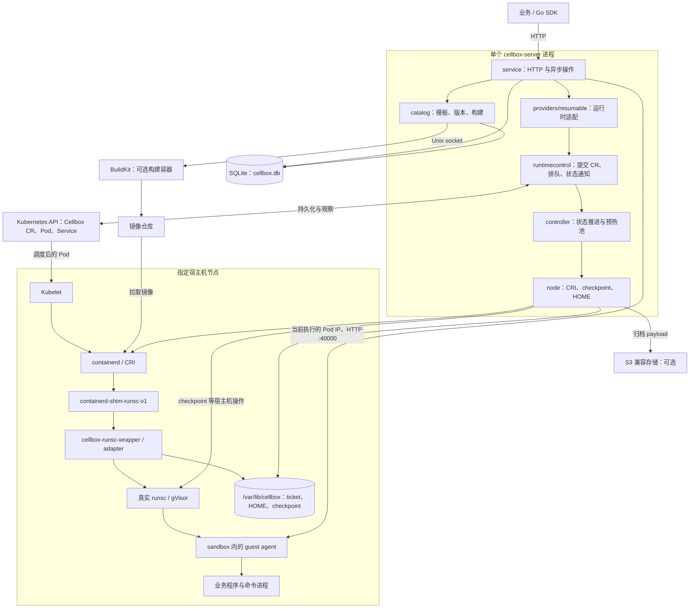
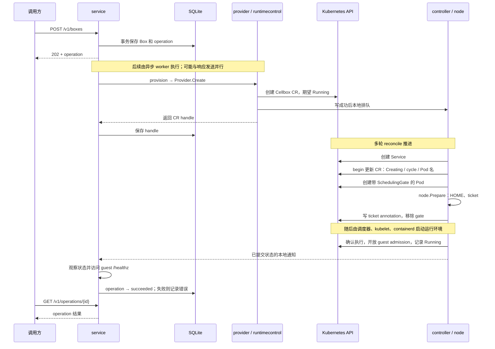

# Cellbox 整体架构与创建链路

本文按当前单机 Kubernetes 实现说明架构、节点接入和 sandbox 创建流程。应用侧调用示例见 [Go SDK](go-sdk.md)与 [REST 快速开始](rest-quickstart.md)，部署命令见[部署指南](deployment.md)。

## 1. 先区分节点和 sandbox

| 名称 | 含义 |
| --- | --- |
| 宿主机节点 / Kubernetes Node | 预先准备好的机器，运行 kubelet、containerd 和 gVisor；Cellbox 不创建虚拟机，也不负责向 Kubernetes 加入节点 |
| `cellbox-server` | 固定在一个节点运行的服务进程，同时提供 HTTP API、controller 和节点后端 |
| Sandbox / Box | 对外暴露的沙箱实例，由 template revision 创建；不是一台 Kubernetes Node |
| Cellbox CR | Kubernetes 中的自定义资源，保存 sandbox 的期望运行状态、当前执行身份和 checkpoint 引用；它拥有实际 Pod、Service |
| Pod | 一次运行或恢复对应的 Kubernetes 执行对象；暂停后会被删除，恢复时创建或领用另一个 Pod |
| gVisor sandbox | Pod 在 gVisor 中的隔离运行环境；业务容器及其中的进程在这里执行 |
| Guest agent | 业务容器内的 `cellbox-container-agent`，负责启动业务程序、执行命令、文件访问等 |

因此，“创建节点”分为两件事：运维接入宿主机节点，以及业务通过 API 在该节点上创建 sandbox。下面分别说明。

## 2. 整体架构



API 与 controller 在同一进程内协作。一次生命周期变更仍先写入 Kubernetes，写成功后直接加入本地工作队列；controller 提交状态后，通过本地订阅通知等待者。这里没有独立 controller 服务间的 HTTP/RPC，也没有用 ConfigMap 传递这些通知。

Kubernetes API 调用、Pod 调度、CRI 调用和 guest HTTP 访问仍然存在。`cellbox-server` Pod 使用特权、`hostPID` 和宿主机挂载来操作指定节点，并不因此与所有 sandbox 处于同一个隔离环境。

### 主要代码分工

| 代码 | 职责 |
| --- | --- |
| [`cmd/cellbox-server`](../cmd/cellbox-server) | 启动与连接各组件，管理单个活动进程及退出顺序 |
| [`internal/service`](../internal/service) | 对外 HTTP、sandbox/operation 记录、生命周期编排、guest 请求 |
| [`internal/catalog`](../internal/catalog)、[`internal/image`](../internal/image) | 模板和多版本管理、镜像解析、BuildKit 构建与发布 |
| [`internal/boxprovider`](../internal/boxprovider)、[`internal/providers/resumable`](../internal/providers/resumable) | 服务层与 Kubernetes 运行时之间的接口及适配 |
| [`internal/runtimecontrol`](../internal/runtimecontrol) | 共用 Kubernetes client、按对象排队、已提交状态通知 |
| [`internal/controller`](../internal/controller) | 推进 CR 状态，创建/删除 Pod 和 Service，维护预热池 |
| [`internal/runtime`](../internal/runtime) | controller 调用节点后端的窄接口；不是另一个服务 |
| [`internal/node`](../internal/node) | 查询/清理 CRI 执行、准备 ticket、checkpoint、恢复准备及节点文件清理 |
| [`internal/adapter`](../internal/adapter) | wrapper 调用的库，在 runsc `create/start` 路径检查 ticket、绑定 HOME、将需要恢复的 `start` 改成 `restore` |
| [`internal/guest`](../internal/guest)、[`internal/guestapi`](../internal/guestapi) | sandbox 内的 agent 实现，以及 server 与 agent 共用的协议 |

## 3. 宿主机节点如何接入

当前没有“创建宿主机节点”的 Cellbox API。运维先准备机器，再部署 server：

1. 安装 Kubernetes / k3s，让机器成为已有的 Kubernetes Node。
2. 安装兼容的完整 gVisor、shim 和 Cellbox wrapper，配置 containerd 的 `runsc-recoverable` handler。shim 实际调用 wrapper，wrapper 最终执行真实 `runsc`。
3. 部署 Chart，设置 `server.nodeName`、namespace、CRI socket 和持久数据目录；Chart 提供对应的 Kubernetes 运行资源，宿主机组件仍需单独安装。
4. server 中的 Kubernetes profile 必须指向同一个节点与 namespace。当前没有多节点调度器；上层决定使用哪个单机 server。

完整安装、运行时配置和升级限制见[节点安装指南](node-installation.md)。

### server 启动后做什么

入口是 [`main.go`](../cmd/cellbox-server/main.go)，组件组装在 [`runtime.go`](../cmd/cellbox-server/runtime.go) 的 `newRuntime`、`serveUnified`：

1. 校验配置，取得按节点、namespace 划分的 Kubernetes Lease，保证只有一个活动进程。这是 server 运行保护，与已删除的对外 sandbox 租约 API 不同。
2. 创建 provider、共享 `runtimecontrol.Client`、controller manager 和 `node.Backend`；连接本机 CRI。
3. 打开唯一的 `cellbox.db`，初始化 service 和 catalog，再把共用的 checkpoint 索引、归档存储交给节点后端。
4. 启动 HTTP、reconcile、预热池维护和节点清理循环。CR/Pod watch 用于观察外部变化，并在重启后重新推进已有资源。

后台循环与 HTTP handler 并行运行。对某个 sandbox 的工作按对象 key 排队；多个 sandbox 可以并行推进，不需要把所有节点操作串成一个大任务。

## 4. 创建前：模板如何变成可运行版本

```text
管理员配置 profile
  → 创建 template
  → 提交构建：基础镜像 + buildCommand + runCommand + profile
  → 解析基础镜像 digest，调用 BuildKit 安装工具并注入 guest agent
  → 发布镜像，保存不可变 revision 和运行配置快照
  → 直接指定 revision 创建，或先把 template stable 指向它
```

`buildCommand` 在构建容器中执行，可安装业务自定义工具；它不会在每次创建 sandbox 时重新执行。`runCommand` 是启动配置输入，按字面 `docker run ...` 语法解析，不会在 server 上执行 Docker 命令。业务启动命令交由 guest agent 启动，Kubernetes 容器的入口则是注入的 agent。

`templateId` 会在创建请求中解析为当时的 stable revision；`revisionId` 则直接固定版本。解析后的镜像 digest、CPU、内存和 guest 配置写入该 sandbox 的记录，后续切换 stable 不影响已有实例。版本、工具更新和预热配置的完整语义见[使用流程](cellbox-usage.md)。

## 5. 全新 sandbox 的创建链路

以没有 checkpoint、`staged=false` 的 Kubernetes sandbox 为例，请求为：

```http
POST /v1/boxes
Content-Type: application/json

{"revisionId":"rev-...","ownerKey":"业务关联标识"}
```

也可把 `revisionId` 替换成 `templateId`，两者必须且只能提供一个。`ownerKey` 用来关联业务，不用于唯一约束或请求去重。

### 5.1 从 HTTP 到 Kubernetes 对象



图中的 `202` 表示受理。异步 worker 的实际执行可能早于响应发送，不保证此时 CR 已经创建，也不表示 sandbox 已经可用。

具体分工如下：

1. **service 接单。** `create` 校验输入，从 SQLite 解析 revision，用同一事务保存 `Box(creating)` 和 operation，再启动 `provision`。请求不等待 Pod 启动。
2. **provider 创建 CR。** `buildWanted` 把配置转换成 `Cellbox` 自定义资源，固定节点、镜像、资源限制和 agent 入口。`Provider.Create` 返回的 handle 关联 CR UID，不负责直接创建 Pod。源码中的 Go 类型仍叫 `ResumablePod`，实际 Kubernetes Kind 是 `Cellbox`。
3. **controller 创建 Service 和 Pod。** 为 CR 添加清理 finalizer，创建由它拥有的 Service；`begin` 增加执行 cycle、确定 Pod 名、写入 `Creating`。后续 reconcile 创建同样由 CR 拥有的 Pod，设置 `RuntimeClass=runsc-recoverable`、节点选择器和 `RestartPolicy=Never`。
4. **准备完成后允许调度。** Pod 最初带 `cellbox.local/prepared` SchedulingGate，调度器暂不调度。controller 得到 Pod UID 后调用 `node.Backend.Prepare`，准备持久 HOME（启用时）和绑定该 Pod 的 ticket；成功后写入 ticket annotation 并移除 gate。此步骤只准备运行条件，不启动容器。

Service 此时可以已经存在，但没有可服务的运行实例。它通过 CR owner UID 和 `serving` 标签选择当前 Pod，暂停/恢复期间保持自身身份。

对应源码：[HTTP 入口](../internal/service/http.go)、[`create/provision/waitState`](../internal/service/service.go)、[`buildWanted/Provider.Create`](../internal/providers/resumable/provider.go)、[`begin/Reconcile`](../internal/controller/reconciler.go)、[`executionPod`](../internal/controller/warm_pool.go)、[`Prepare`](../internal/node/backend.go)。

### 5.2 从 kubelet 到业务进程

```text
调度器分配到指定节点
  → kubelet 调用 containerd CRI，拉取镜像并准备 Pod
  → 创建 PodSandbox（root sandbox）
      → shim → wrapper create：校验 Pod 与 ticket → runsc create
      → shim → wrapper start：冷启动保持原命令 → runsc start
  → 创建 sandbox 内的业务容器
      → shim → wrapper create：检查身份、绑定持久 HOME → runsc create
      → shim → wrapper start：检查当前执行 → runsc start
  → 容器入口 cellbox-container-agent serve
      → Bootstrap 准备用户、目录及工具环境
      → 非 staged 实例启动业务程序
      → 提供 :40000 guest HTTP API
```

这里的 shim 是 `containerd-shim-runsc-v1`。wrapper 是宿主机上的命令包装进程，`internal/adapter` 是它使用的库。它通过共享的节点 ticket 文件获得授权与恢复参数，不需要向 `cellbox-server` 发 RPC，也不读取 SQLite；检查并按需改写参数后，最终 `exec` 真实 `runsc`。

这里有两个层次：gVisor 的 root sandbox，以及 sandbox 内运行 agent 的业务容器。HOME 绑定发生在业务容器的 OCI `create` 路径，避免把不同 sandbox 的可写目录混在一起。ticket 还会检查 Pod UID 等身份，拒绝复用不属于当前执行的准备记录。

对应源码：[`wrapper 入口`](../cmd/cellbox-runsc-wrapper/main.go)、[`Adapter.Rewrite/Main`](../internal/adapter/adapter.go)、[`HOME 绑定`](../internal/adapter/home.go)、[`agent 入口`](../cmd/cellbox-container-agent/main.go)、[`guest 启动`](../internal/guest/server.go)。

### 5.3 什么时候才算创建成功

| 阶段 | 已经说明什么 | 尚不说明什么 |
| --- | --- | --- |
| HTTP `202` | operation 已持久化并受理 | CR、Pod、容器已经存在 |
| CR 已创建 | sandbox 的期望运行状态已写入 Kubernetes | Pod 已启动 |
| container 执行已确认、CR `Running` | controller 确认当前运行身份并开放 guest admission | 业务服务健康 |
| 创建 operation `succeeded` | service 已观察到目标状态，并成功访问 guest `/healthz` | 业务端口已完成初始化或应用自检 |

Pod 的 TCP readiness probe 检查 guest 端口；创建 operation 还会等待 guest HTTP `/healthz` 成功。它们都不是业务应用的健康检查。调用方应等待 operation 结束，需要业务就绪时再检查自己的应用接口。

如果请求使用 `staged=true`，guest 控制 API 启动，但业务程序暂不启动；创建完成后的 Box 为 `staged`，由调用方显式激活。

## 6. 暂停、恢复与预热池在哪一层

暂停与全新创建的区别，是要保存当前进程状态：

```text
suspend
  → guest quiesce：检查活动命令并关闭新命令入口
  → CR 期望状态改成 Suspended
  → controller 撤下 serving，node 执行 gVisor checkpoint 并提交节点文件
  → 删除旧 Pod，CR 进入 Suspended

resume
  → 更新 CR 的期望状态与本次 transition
  → controller begin：有兼容预热槽则领用，否则创建普通恢复 Pod
  → node 校验 checkpoint / HOME / 运行时身份并准备恢复 ticket
  → wrapper 将 root sandbox 的 start 改写为 runsc restore
  → 确认新执行、重新开放 guest admission、发布 Running
  → service 收到本次 transition 的 Running + GuestReady 观察，再完成 operation
```

恢复保留 Box 与 CR，Pod UID 和执行 generation 可以变化。操作后应使用 SDK 返回的新 handle，REST 调用方则重新查询 sandbox。当前恢复以同一节点上的 checkpoint 为基础，没有跨节点自动迁移。

恢复的完成条件与首次创建不同：节点后端先通过 CRI 确认执行身份，再向确切 Pod IP 调用 guest resume 接口，重新开放 admission。controller 提交这次 transition 的就绪状态后，service 依据进程内观察完成 operation，不额外轮询 guest `/healthz`。对应实现是 [`launchNodeResume`](../internal/service/node_resume.go)、[`waitNodeResume`](../internal/service/runtime_feed.go) 和 [`node.ResumeGuest`](../internal/node/resume_guest.go)。

### 预热具体提前做了什么

预热需求来自节点上现有的 checkpoint。server 的预热池循环每 500 ms 列出本节点处于 `Suspended` 且有 checkpoint 的 Box，按兼容运行配置分组（每组 1–2 个槽），受节点总预算约束，提前创建兼容的 Pod 和 gVisor root sandbox。revision 的 `warmSlots` 不再决定需求。

空闲槽位的 root sandbox 已完成 `runsc create`，wrapper 在它的 `start` 路径等待领用；此时真实 `runsc start/restore` 尚未执行，也没有业务容器或 guest 程序在运行。池的 `readySlots` 表示槽位已进入这种等待状态。

恢复请求领用后，节点后端准备该 Box 的 ticket、checkpoint 和 HOME，再通知等待中的 wrapper 执行 `restore`。持久 HOME 仍在后续业务容器的 OCI `create` 阶段绑定到 `/home/agent`，空闲池不会提前挂入某个 Box 的 HOME。恢复改写发生在 root sandbox 的 `start`，不是业务容器的 `start`。

兼容运行指纹相同的 revision 可以共享池；不同镜像或不同运行配置不能随意混用。池属于兼容配置，不属于某一个业务 Pod。

**当前全新创建不领取预热槽。** `begin` 只有在 `Status.Snapshot` 非空时才尝试 `WarmPool.acquire`。池未命中时使用普通 checkpoint 恢复；这只是重新准备恢复环境，不是丢弃 checkpoint 后冷启动业务。预热机制、预算与排查见[预热池](warm-pool.md)。

对应源码：[`controller.WarmPool`](../internal/controller/warm_pool.go)、[`node 预热状态与领用`](../internal/node/warm.go)、[`adapter 等待与改写`](../internal/adapter/adapter.go)。

## 7. 命令、文件与归档走哪里

命令和文件操作的主链路是：

```text
业务 / SDK
  → cellbox-server：校验 Box、generation 与当前执行身份
  → provider：核对 CR、Pod、Service ownership，确定当前执行的 Pod IP
  → guest HTTP API
  → sandbox 内执行命令或访问 workspace
  → server 保存执行结果 / 返回文件数据
```

当前 Kubernetes provider 直接访问经身份检查的 Pod IP，避免恢复后还要等待 Service 的 EndpointSlice 路由更新。Service 仍被创建、保留并校验。命令不在宿主机执行，也不依赖 `kubectl exec`。访问暂停的实例不会自动触发 resume。

归档是另一条能力：从已停止且没有写入者的持久 HOME 导出工作区，payload 存到 S3。它不包含 gVisor 进程内存；恢复归档会创建新的 staged sandbox，导入工作区后由调用方激活。checkpoint 用于恢复同一个实例的进程状态，归档用于上层显式迁移工作区。

## 8. 数据存在哪里，谁负责什么

| 位置 | 内容与权责 |
| --- | --- |
| server 持久目录的 `cellbox.db` | 模板、revision、构建 operation，以及 Box、生命周期 operation、执行记录/结果、归档元数据、checkpoint 索引；业务元数据从这里查询 |
| 同一目录的 `logs/` | 构建日志正文，避免把大量构建输出写进 SQLite |
| Kubernetes | Cellbox CR 的期望/观察运行状态、当前 Pod 身份与 checkpoint 引用，以及实际 Pod、Service 和 ownership；另有部署所需的配置、RBAC、RuntimeClass 与进程 Lease |
| 节点 `/var/lib/cellbox` | 运行时 ticket/claim、持久 HOME、checkpoint 内容及诊断文件；server 与宿主机 wrapper 通过这里交接准备结果 |
| containerd 与 gVisor 的运行目录 | 镜像与容器 rootfs、CRI/运行时执行状态；不作为模板 catalog |
| 镜像仓库 | 基础镜像与构建后固定 digest 的 revision 镜像 |
| S3 兼容对象存储，可选 | 归档 payload；没有配置时，归档相关能力直接报不支持 |
| BuildKit 本地缓存 | 镜像构建中间内容；不是 revision 或运行记录的权威来源 |

SQLite 只有四张业务表：`templates`、`template_revisions`、`operations`、`runtime_records`。其中独立的 `operations` 表存构建任务，其他运行操作按类型存入 `runtime_records`，不是每种资源各有一份数据库。

SQLite 中的 Box 记录保存对外身份、业务归属、固定版本、操作结果及观察投影；CR 保存 Kubernetes 执行所需的期望与当前状态。两者有明确边界：SQLite 事务不能与 Kubernetes 写入组成一个原子事务。因此中断后可能留下“结果未知”，不能只凭某一条 operation 失败就断定运行资源不存在。

进程内仍有工作队列、订阅通知、锁、活动调用和最新预热观察等临时数据，但没有维护另一份完整业务记录账本。重启后从 SQLite 和 Kubernetes 读取持久记录；checkpoint 恢复仍依赖原节点上的文件。

## 9. 失败与能力边界

- `202` 和网络超时都不能证明最终成功或失败。保留 operation ID，查询 operation 与 sandbox 后，再由上层决定下一步。
- `ownerKey`、`Idempotency-Key` 不提供请求去重承诺。重复提交创建、构建或命令会形成独立请求。
- server 重启不会自动重放无法确认的 API 操作；中断的 operation 标记 `UNKNOWN_OUTCOME`，命令执行状态可能为 `unknown`。controller 仍会按持久 CR 推进或清理资源，这与重新执行一遍业务请求不同。
- 运行实例丢失或恢复失败，不会偷偷切成新的冷启动业务实例；失败会暴露给上层。销毁时通过 finalizer 清理运行资源与节点数据。
- Docker provider 只提供基础创建、查询、命令、文件、直接服务代理和销毁。上述 Kubernetes CR、gVisor checkpoint 与预热链路不适用于 Docker；复杂生命周期能力直接返回 `UNSUPPORTED_CAPABILITY`。

接口定义见 [OpenAPI](../api/openapi.yaml)，可运行验收及证据标准见[端到端验证](e2e-validation.md)。
