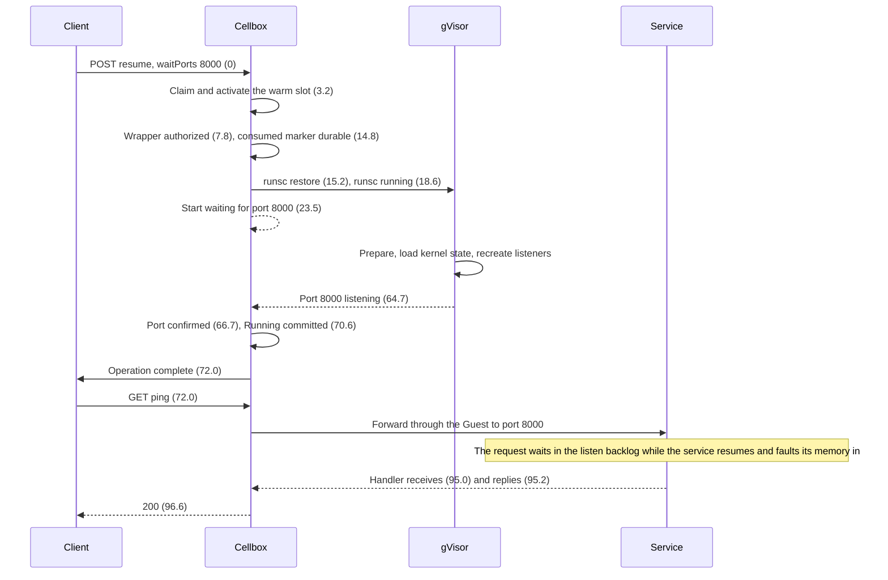

# Resume timeline

This page follows one warm resume across four layers, from the client's request to the first response of a web service inside the Box. It is the reference for what Cellbox optimizes, what is left, and which layer owns each part. How the fast path works is described in [Resume on Kubernetes](resume-on-kubernetes.md).

## What the client sees

The measured client resumes a suspended Box and then calls a trivial endpoint of the service inside it:

1. `POST /v1/boxes/{id}:resume` with `{"expectedGeneration": ..., "waitPorts": [8000]}`.
2. The operation completes: port 8000 is listening again.
3. Right away, `GET /v1/boxes/{id}/services/8000/ping` through the API proxy.
4. The `ping` response arrives.

| Client event | Median | p90 | Range |
| --- | ---: | ---: | --- |
| Resume request sent | 0 ms | | |
| Operation complete (port ready) | 72.0 ms | 80.0 ms | 61.9-86.9 ms |
| `ping` response received | **96.6 ms** | 108.4 ms | 81.2-147.6 ms |

The figure is the time from the resume request to the `ping` response. It includes everything a web client waits for and nothing that depends on the service's own work, since the handler takes under 0.2 ms.

## Conditions

Measured on 2026-10-31 on one k3s node (8 cores), with the client on the same node calling the API through its ClusterIP, so there is no external network in the path. That keeps the numbers stable.

- gVisor `cellbox-gvisor-20261030`; server built from commit `51ec52f`.
- Template `mybox` (a production agent template that also runs a Node.js launcher and the Codex app server), with a small Go HTTP service on port 8000 whose `/ping` returns a fixed JSON body.
- 20 serial resumes, every one a warm-pool hit. The service kept its PID and its request counter across all of them.
- The checkpoint files, the gVisor release and the wrapper were read into the page cache before each resume. 19 of the 20 windows had no disk read, and the remaining one had a single read.

Timestamps come from the client, the server's stage log, the wrapper's timing marks, the `runsc` debug log, a bpftrace probe on the host socket entering `LISTEN`, and the service itself. The service reads the sandbox clock, which follows the host clock.

## Swimlanes

```mermaid
gantt
    title Warm resume to first ping (median, ms)
    dateFormat x
    axisFormat %L
    section Client
    POST resume, wait for port         :u1, 0, 72
    GET ping, wait for response        :u2, 72, 97
    section Cellbox
    API and slot claim                 :c1, 0, 3
    Wake the waiting wrapper           :c2, 3, 8
    Consumed marker, two fsyncs        :crit, c3, 8, 15
    Start runsc restore                :c4, 15, 19
    Wait for the port (eBPF)           :c5, 24, 67
    Confirm and commit Running         :c6, 67, 72
    Proxy the ping response            :c7, 95, 97
    section gVisor
    Prepare and load kernel state      :g1, 19, 65
    Run tasks, load pages on fault     :g2, 65, 95
    section Service
    Memory restored, not yet running   :b0, 19, 65
    Running, faulting pages in         :b1, 65, 95
    Handle ping                        :b2, 95, 96
```

## Where the time goes

Median offsets from the resume request:

| Segment | From | To | Median | Owner | What happens |
| --- | ---: | ---: | ---: | --- | --- |
| API and claim | 0 | 3.2 | 3.2 ms | Cellbox | Admit the request, commit the transition locally, claim and activate a warm slot |
| Wake the wrapper | 3.2 | 7.8 | 4.6 ms | Cellbox | The waiting wrapper learns through inotify that its slot was claimed |
| Consumed marker | 7.9 | 14.8 | 6.9 ms | Cellbox | Make the checkpoint unreplayable: fsync of the marker file and of its directory (6.6 ms) |
| Start runsc | 15.2 | 18.6 | 3.4 ms | Cellbox, gVisor | Bind HOME, exec `runsc restore`, `runsc` process start |
| gVisor restore | 18.6 | 64.7 | 46 ms | gVisor | Prepare the platform, load the kernel state (23-34 ms in a separate run), recreate listening sockets last |
| Port confirmed | 64.7 | 66.7 | 2.0 ms | Cellbox | The eBPF monitor sees `LISTEN` and rechecks the socket table |
| Commit | 66.7 | 72.0 | 5.3 ms | Cellbox | Hand back to the reconcile queue (2.5 ms), confirm, invalidate, mark serving, commit (1.4 ms), notify the client (1.4 ms) |
| Service resumes | 72.0 | 95.0 | 23 ms | gVisor, service | Tasks run; first touches of memory wait for page loading; the request sits in the backlog |
| Reply | 95.0 | 96.6 | 1.6 ms | Service, Cellbox | Handler (0.2 ms), response back through the Guest and the API proxy |

In total, Cellbox owns about 25 ms, gVisor and the resuming service about 69 ms, and the reply about 2 ms.

## What has been optimized

Without the fast path, a resume creates a Pod, starts a sandbox, restores all memory and waits for Kubernetes. The fast path moves or removes each of those steps:

| Step | Before | Now |
| --- | --- | --- |
| Pod and sandbox creation | In the request | Done ahead of time by the [warm pool](warm-pool.md); the claim takes under 1 ms |
| Binding the checkpoint | Fixed when the sandbox starts | Deferred: any compatible slot can take any Box's checkpoint |
| Loading memory | All pages before the process runs | Lazy: pages load when touched |
| Kubernetes writes | Waited for | Committed to a local journal first; Kubernetes is updated afterwards |
| Disk waits | Several fsyncs per resume | One durable marker; other records are written without waiting |
| Completion | kubelet Pod status | Local CRI plus an eBPF port monitor |
| Sandbox PID lookup | A verbose CRI call per step (about 17 ms each on a busy node) | Cached per sandbox |

## What is left

Cellbox, about 10 ms within reach:

- **Consumed marker:** pre-create the marker file when suspending, so a resume needs one `fdatasync` instead of two fsyncs (about 3 ms).
- **Wrapper wake-up:** inotify should take microseconds. The 4.6 ms between activation and the wrapper's authorization has not been explained.
- **Commit hand-off:** commit `Running` from the goroutine that saw the port instead of going back through the reconcile queue (about 2 ms).

gVisor, most of the remaining time:

- **Faults after the restore.** While pages are still loading, a fault on one page maps, and waits for, the whole 32 MiB window around it (`asyncLoadMapUnit` in `pkg/sentry/mm`). After a resume, the Box's processes read 10-40 MB during the first command. Waiting only for the faulting page and loading the rest of the window in the background would let the request through sooner. Shrinking the window to 2 MiB or 256 KiB is the first experiment.
- **Kernel state load.** It is CPU-bound: the checkpoint state file is 0.3-0.7 MB, and evicting it from the page cache changed the load time by no more than the run-to-run spread. The cost grows with the number of kernel objects, so it needs a CPU profile before any change.

Template: every resident process adds kernel state to load and memory to fault in. On the same Box, a Node.js service instead of Go added about 12 ms after the operation completed. A template with only the Guest and the service measured about 75 ms to the first response on an earlier build.

## Reproducing

Run the client on a node that hosts Cellbox, wait for `readySlots > 0` on the revision's warm pool, then time `POST :resume` with `waitPorts` and an immediate request to a trivial endpoint through `/v1/boxes/{id}/services/{port}/...`. Report the median and p90 of many serial runs with the conditions above. Set `CELLBOX_TRACE_TIMINGS=true` in the wrapper script to get the wrapper marks in `timings.log` under the node base.
